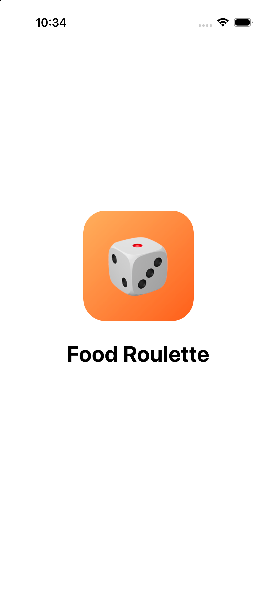
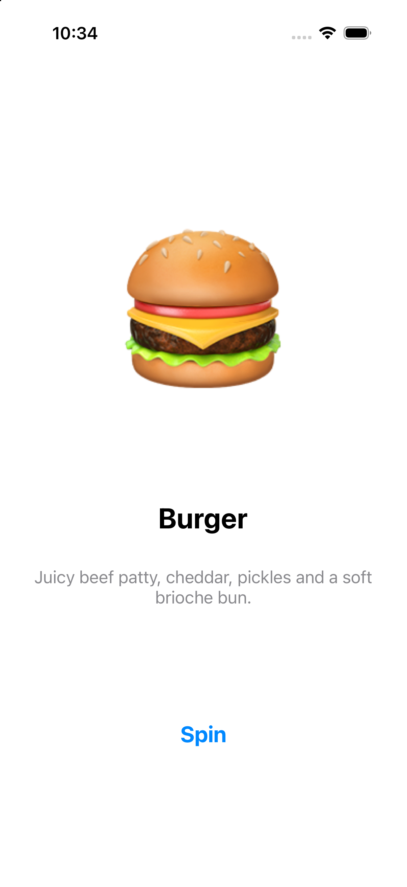
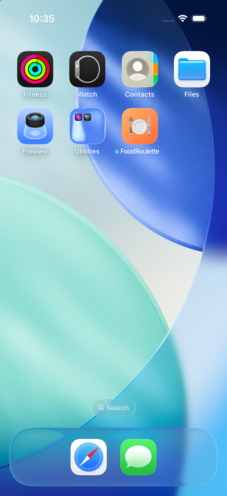

# Lab 6 · Favorites Roulette

A single-screen iOS app (UIKit, Storyboard, Swift) that shows a random card from my 10 favorite foods.
Tap **Spin** to get a random dish; the same dish never appears twice in a row.

- Data: an array of `Favorite` structs (`Favorite.swift`) with images in `Assets.xcassets`
- Layout: `Main.storyboard` and `LaunchScreen.storyboard`, no Auto Layout constraints
- Custom app icon (1024×1024, no transparency) and custom launch screen

## Screenshots

| Launch screen | Main screen | Home Screen |
|---|---|---|
|  |  |  |
