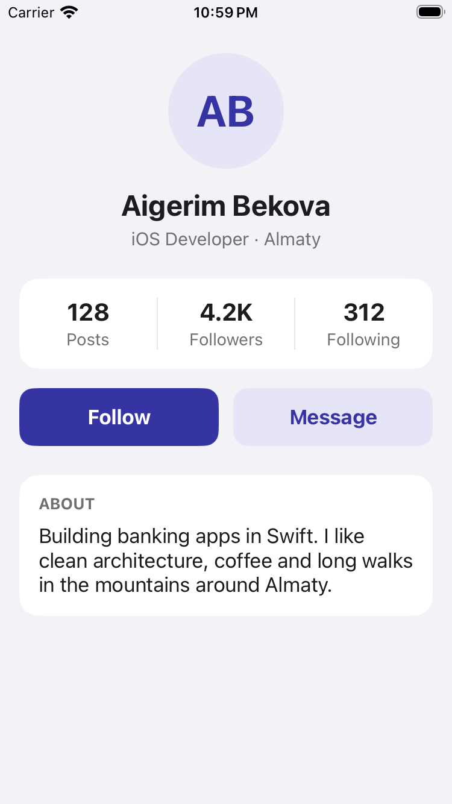
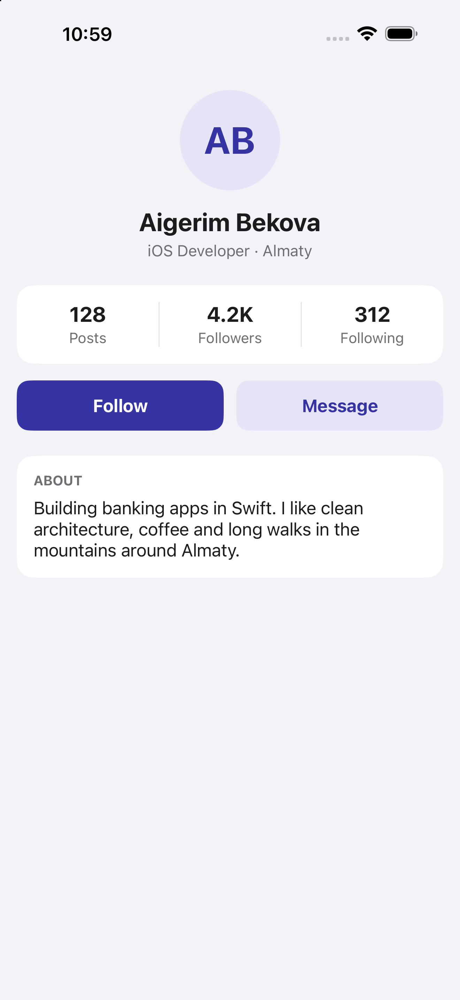
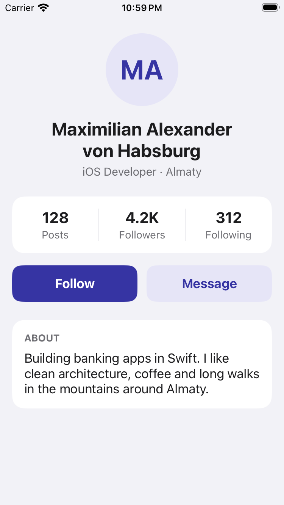
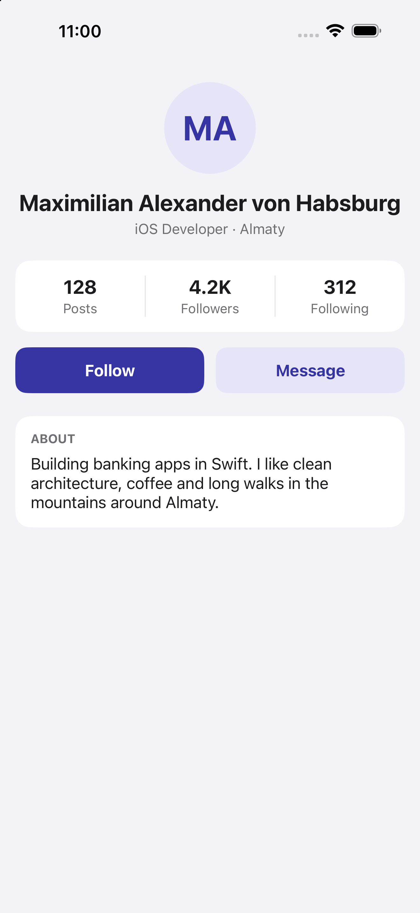

# Assignment 7 · Auto Layout (Variant A · Profile)

UIKit + Storyboard only. Every view and constraint is set in `Main.storyboard`, with no `UIStackView`.
`ViewController.swift` only fills in data.

- Avatar: 96 × 96 circle, centered
- Name: up to 2 lines, centered
- Stats: 3 equal-width columns (Equal Widths) with 1 pt dividers
- Follow / Message: equal widths, 12 pt gap, 48 pt tall
- About: wraps with no line limit
- 16 pt side margins, everything inside the safe area

## Screenshots

| | iPhone SE (3rd gen) | iPhone 16 Pro Max |
|---|---|---|
| Default |  |  |
| Long name |  |  |
